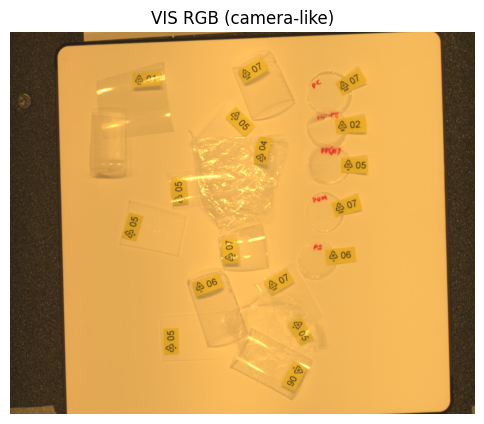
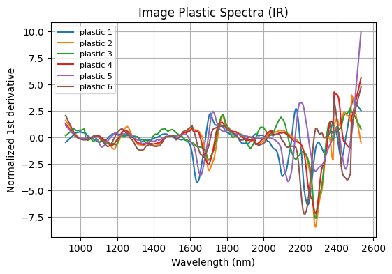
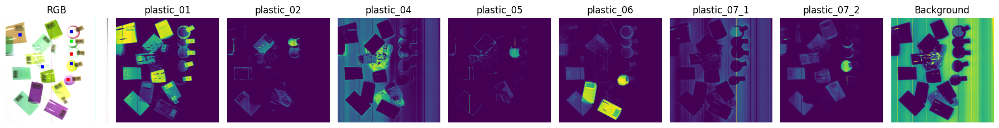

# Applied Hyperspectral Imaging and Spectral Analysis

## Project Overview

This repository presents practical applications of hyperspectral
imaging, spectral analysis, material identification and machine
learning.

The experiments were conducted during the Advanced Spectral
Imaging course at the University of Eastern Finland as part
of the Erasmus Mundus MSc in Computational Colour and Spectral
Imaging (COSI).

## Imaging Systems

- Specim visible-range scanner
- Specim infrared scanner
- Specim IQ hyperspectral camera
- Tunable spectral imaging system

## Applications

1. Green material segmentation
2. Plastic leaf and stem segmentation
3. Medical powder analysis
4. Plastic identification and spectral unmixing
5. Plant species segmentation
6. Flower condition classification

---

## 1. Green Material Segmentation

### Objective

Investigate the ability of hyperspectral imaging to discriminate
materials that exhibit similar visual colours but different
spectral reflectance properties.

### Methodology

Hyperspectral cubes were radiometrically corrected using white
and dark reference measurements. A representative reference
spectrum was extracted from a selected material patch.

Spectral Angle Mapper (SAM) was applied to identify pixels with
spectral signatures similar to the reference spectrum.

PCA, band selection and K-means clustering were also evaluated.

### 1.1 Visible and near infrared-Range Scanner

<table>
<tr>
<th>RGB and Reference Selection</th>
<th>Reflectance Spectrum</th>
<th>Segmentation Result</th>
</tr>
<tr>
<td></td>
<td></td>
<td></td>
</tr>
</table>

### Result Analysis

Although several objects appear green in the RGB image,
their spectral reflectance characteristics differ.

The selected reference spectrum exhibits distinct reflectance
features across the visible and near-infrared wavelengths.

SAM isolates the selected material based on spectral similarity
rather than conventional RGB colour information.

### Potential Industrial Applications

- Material identification
- Industrial machine vision
- Automated sorting
- Product inspection
- Quality control

---

## 2. Plastic Leaf and Stem Segmentation

### Objective

Investigate the spectral differences between plastic leaf and
stem components using infrared hyperspectral imaging and
spectral segmentation techniques.

### Imaging System and Methodology

- Specim infrared hyperspectral scanner.
- White and dark reference correction.
- Reference material selection and spectral extraction.
- Spectral Angle Mapper (SAM).
- Principal Component Analysis (PCA).
- K-means clustering.

### Experimental Results

<table>
  <tr>
    <th>Reference Material Selection</th>
    <th>Spectral Reflectance</th>
    <th>Segmentation Result</th>
  </tr>
  <tr>
    <td>
      
    </td>
    <td>
      
    </td>
    <td>
      
    </td>
  </tr>
  <tr>
    <td colspan="3" align="center">
      <b>Figure 1:</b> Plastic stem segmentation using Spectral Angle Mapper (SAM).
    </td>
  </tr>
  <tr>
    <td>
      
    </td>
    <td>
      
    </td>
    <td>
      
    </td>
  </tr>
  <tr>
    <td colspan="3" align="center">
      <b>Figure 2:</b> Plastic leaf segmentation using K-means clustering.
    </td>
  </tr>
</table>

### Spectral Analysis and Results

The extracted infrared reflectance spectra reveal distinct
spectral characteristics between the plastic leaf and stem
materials across approximately 900–2500 nm.

The stem reference spectrum exhibits pronounced reflectance
minima around 1200, 1400 and 1730 nm, while the leaf reference
spectrum exhibits a different reflectance profile, including
a substantial decrease beyond approximately 2200 nm.

These spectral differences provide useful information for
distinguishing the two material components.

Spectral Angle Mapper (SAM) selectively highlights the stem
components based on spectral similarity to the reference
signature, whereas K-means clustering identifies predominantly
leaf regions through unsupervised spectral grouping.

The results demonstrate the potential of infrared hyperspectral
imaging to discriminate material components beyond conventional
RGB-based identification.

### Potential Industrial Applications

- Plastic material identification and sorting.
- Automated component inspection.
- Industrial quality control.
- Recycling and waste management.
- Spectral machine vision.

## 3. Medical Powder Identification

### Objective

Investigate the spectral characteristics of different medical
powder samples and identify optimal wavelength combinations
for enhanced material discrimination using visible and
short-wave infrared (SWIR) hyperspectral imaging.

### Methodology

Nine representative sample patches were selected to investigate
their wavelength-dependent reflectance characteristics.

Following white and dark reference correction, the spectral
analysis involved:

- Extraction of visible and SWIR reflectance signatures.
- Spectral smoothing and comparison of powder samples.
- Identification of three informative SWIR spectral regions.
- Automated evaluation of wavelength combinations by selecting
  one wavelength from each spectral region.
- Variance-based optimization of false-colour RGB representations
  to enhance material contrast.

### Experimental Results

<table>
  <tr>
    <th>Visible RGB and Selected Samples</th>
    <th>Visible Reflectance Spectra</th>
  </tr>
  <tr>
    <td>
      
    </td>
    <td>
      
    </td>
  </tr>
  <tr>
    <th>SWIR Spectral Signatures</th>
    <th>Optimized SWIR False-Colour Visualization</th>
  </tr>
  <tr>
    <td>
      
    </td>
    <td>
      
    </td>
  </tr>
  <tr>
    <td colspan="2" align="center">
      <b>Figure:</b> Comparison of visible and SWIR spectral
      characteristics and enhanced material discrimination
      using optimized wavelengths of 1503, 2001 and 2393 nm.
    </td>
  </tr>
</table>

### Spectral Analysis and Interpretation

#### Visible Spectral Region (400–700 nm)

The conventional RGB image shows several powder samples with
similar white, cream and pale-yellow appearances, making their
visual differentiation challenging.

Although the visible reflectance curves exhibit differences
in spectral intensity and shape, several sample signatures
overlap considerably, limiting their visual discrimination
using conventional RGB imaging.

#### SWIR Spectral Region (1000–2500 nm)

The SWIR measurements reveal substantially greater spectral
variation among the selected samples.

Several samples exhibit pronounced reflectance minima around
1200, 1450 and 1950 nm, while others maintain relatively high
reflectance across broader wavelength intervals.

Distinct reflectance profiles are also observed beyond 2200 nm.
These wavelength-dependent characteristics provide additional
information for distinguishing visually similar powder materials.

#### Optimal Spectral Band Selection

Based on the SWIR reflectance characteristics, three informative
spectral regions were identified for wavelength optimization.

Different wavelength combinations were automatically evaluated
by selecting one candidate wavelength from each spectral region.
A variance-based optimization criterion was applied to identify
the combination that maximized image contrast.

The resulting optimal wavelength combination was:

| RGB channel | Spectral region | Optimal wavelength |
|---|---|---:|
| Red | Band 1 (1450–1850 nm) | **1503 nm** |
| Green | Band 2 (2000–2200 nm) | **2001 nm** |
| Blue | Band 3 (>2200 nm) | **2393 nm** |

#### Optimized False-Colour Image Analysis

The optimized SWIR false-colour representation provides
substantially clearer visual separation between powder samples
than the conventional RGB image.

Powder regions that previously appeared visually similar are
represented by distinct red, green, brown, pink and cream
colours, improving their visual discrimination.

The result demonstrates that selecting informative wavelengths
from complementary spectral regions can enhance material
contrast without requiring the visualization of the entire
hyperspectral cube.

This approach also illustrates the potential of hyperspectral
imaging for identifying application-specific wavelengths that
could support the development of targeted multispectral
inspection systems.

### Key Findings

- Conventional RGB imaging provides limited visual discrimination
  between powders with similar appearances.
- SWIR imaging reveals additional material-specific reflectance
  characteristics.
- Variance-based wavelength optimization identifies informative
  spectral combinations for enhanced visualization.
- The selected wavelengths of 1503, 2001 and 2393 nm provide
  clearer visual separation between powder regions.
- Hyperspectral analysis can support application-specific
  multispectral sensor configuration.

### Potential Industrial Applications

- Pharmaceutical raw material inspection.
- Powder and chemical material discrimination.
- Detection of material inconsistencies.
- Non-destructive pharmaceutical quality control.
- Application-specific spectral band optimization.
- Development of targeted multispectral inspection systems.

**Experimental scope:** These results demonstrate laboratory-scale
spectral material discrimination and wavelength optimization
rather than independently validated chemical identification
or quantitative classification accuracy.

## 4. Plastic Polymer Identification and Spectral Unmixing

### Objective

Investigate the potential of hyperspectral imaging to
identify and differentiate plastic polymers that exhibit
similar visual appearances in conventional RGB images.

### Methodology

Visible and infrared hyperspectral measurements were used
to investigate the spectral characteristics of different
plastic samples.

The analysis involved:

- White and dark reference correction.
- Extraction of representative plastic spectral signatures.
- First-order spectral derivative computation.
- Spectral normalization.
- Selection of representative material endmembers.
- Spectral unmixing using Non-Negative Least Squares (NNLS).
- Generation of material-specific abundance maps.

### Experimental Results

<table>
  <tr>
    <th>Conventional RGB Visualization</th>
    <th>Infrared Plastic Spectral Signatures</th>
  </tr>
  <tr>
    <td>
      
    </td>
    <td>
      
    </td>
  </tr>
  <tr>
    <td colspan="2" align="center">
      <b>Figure 1:</b> Conventional RGB appearance and
      normalized first-order infrared spectral derivatives
      of different plastic samples.
    </td>
  </tr>
</table>

### Spectral Analysis and Interpretation

#### Conventional RGB Imaging

Most plastic samples appear transparent or exhibit similar
visual characteristics in the conventional RGB image.

Despite differences in their material composition, their
similar colour and transparency make reliable polymer
identification challenging using RGB imaging alone.

#### Infrared Spectral Characteristics

The normalized first-order derivative spectra reveal
distinct wavelength-dependent characteristics across
approximately 900–2500 nm.

Pronounced spectral differences are observed in several
wavelength regions, particularly:

| Spectral region | Observed characteristics |
|---|---|
| 900–1500 nm | Relatively limited spectral variation |
| 1600–1800 nm | Distinct derivative peaks and troughs |
| 2000–2300 nm | Pronounced differences between plastic signatures |
| 2300–2500 nm | Additional spectral variation and potential discrimination features |

These differences provide useful spectral information for
distinguishing plastic materials that are difficult to
differentiate using conventional RGB imaging.

First-order derivative preprocessing helps emphasize
spectral features and reduce baseline variations, while
normalization facilitates comparison between material
signatures.

### Plastic Identification Using Spectral Unmixing

Non-Negative Least Squares (NNLS) spectral unmixing was
applied to estimate the contribution of selected reference
material signatures at individual image pixels.

The resulting abundance maps represent seven plastic
reference signatures and a background component.

  

  <b>Figure 2:</b> Spectral unmixing results showing the
  RGB reference image and material-specific abundance maps
  for plastic_01, plastic_02, plastic_04, plastic_05,
  plastic_06, plastic_07_1, plastic_07_2 and background.

### Result Analysis

The spectral abundance maps reveal the spatial distribution
of different reference material signatures across the
plastic samples.

Several reference signatures produce localized responses
corresponding to specific plastic objects, demonstrating
the potential of infrared spectral information for
material discrimination.

Unlike conventional RGB imaging, spectral unmixing enables
the differentiation of visually similar plastic samples
based on their wavelength-dependent characteristics.

Some abundance maps exhibit overlapping responses and
background contributions, indicating that further
endmember refinement and preprocessing could improve
material discrimination.

### Key Findings

- Conventional RGB imaging provides limited information
  for differentiating visually similar plastic polymers.
- Infrared spectral imaging reveals material-dependent
  spectral characteristics.
- First-order derivatives and normalization enhance
  spectral feature comparison.
- NNLS spectral unmixing provides spatially resolved
  estimates of reference material contributions.
- Hyperspectral imaging demonstrates potential for
  automated plastic identification and sorting.

### Potential Industrial Applications

- Automated plastic sorting and recycling.
- Polymer material identification.
- Waste stream characterization.
- Detection of unwanted materials in recycling processes.
- Industrial material inspection.
- Hyperspectral machine vision for circular economy applications.

**Experimental scope:** These results demonstrate laboratory-scale
plastic material discrimination using reference spectral
signatures. Quantitative polymer identification accuracy
and industrial sorting performance require further validation.
## 5. Plant Species Segmentation

### Objective

Differentiate two plant species using pixel-level spectral
information and supervised neural network classification.

### Methodology

Hyperspectral images were preprocessed using spectral
derivatives and normalization.

Plant regions were manually annotated using GIMP to
generate training data.

Pixel-wise spectral features and corresponding labels
were used to train a fully connected neural network.

| Parameter | Configuration |
|---|---|
| Model | Fully connected neural network |
| Hidden layers | 3 |
| Optimizer | Adam |
| Loss function | Binary cross-entropy |
| Training epochs | 20 |

### Image Annotation

<!-- Insert original and annotated plant images -->

### Segmentation Results

<!-- Insert plant species segmentation results -->

### Result Analysis

The neural network differentiated the two plant species
and background within the evaluated spectral images.

The results demonstrate how spectral signatures can be
combined with machine learning to discriminate biological
materials.

### Potential Industrial Applications

- Precision agriculture
- Plant species identification
- Crop monitoring
- Agricultural machine vision
- Vegetation classification

---

## 6. Flower Condition Classification

### Objective

Investigate the ability of hyperspectral imaging and neural
networks to distinguish old and new rose flowers.

### Methodology

Spectral images were preprocessed and manually annotated
to generate training labels.

Pixel-wise spectral features were extracted and used to
train a fully connected neural network.

| Parameter | Configuration |
|---|---|
| Model | Fully connected neural network |
| Hidden layers | 3 |
| Output layer | Softmax |
| Optimizer | Adam |
| Loss function | Binary cross-entropy |
| Training epochs | 30 |

### Vegetation Indices and Image Annotation

<!-- Insert vegetation indices and annotation images -->

### Classification Results

<!-- Insert original rose image and segmentation result -->

### Result Analysis

The trained neural network differentiated old and new
rose flowers in the evaluated spectral images.

The resulting classification maps highlight the spatial
distribution of the two flower categories.

This experiment demonstrates the potential of spectral
imaging for biological material condition assessment.

### Potential Industrial Applications

- Flower quality assessment
- Agricultural product inspection
- Biological material classification
- Plant condition monitoring

---

## Technical Competencies

### Spectral Imaging and Measurements

- Hyperspectral sample measurements
- Specim imaging systems
- Visible and infrared spectral imaging
- White and dark reference correction
- Spectral reflectance analysis
- Laboratory transmittance measurements

### Spectral Data Analysis

- Spectral Angle Mapper (SAM)
- Principal Component Analysis (PCA)
- K-means clustering
- Hierarchical clustering
- Spectral unmixing
- Non-negative least squares (NNLS)
- Spectral derivatives and normalization
- Optimal wavelength selection

### Machine Learning

- Neural networks
- Supervised classification
- Pixel-wise spectral classification
- Hyperspectral image segmentation

## Source Code

The complete Jupyter notebook contains the Python
implementations and experimental outputs.

[Complete Advanced Spectral Imaging Notebook](ASI_homework2.ipynb)

## Experimental Scope

These projects demonstrate laboratory-scale spectral imaging
applications. The listed industrial applications represent
potential use cases rather than commercially validated systems.

## Author

**Luel Abrha Gebre**

MSc in Computational Colour and Spectral Imaging
(Erasmus Mundus)

MSc in Computer Engineering
